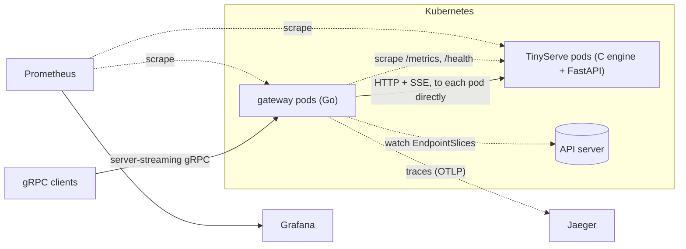
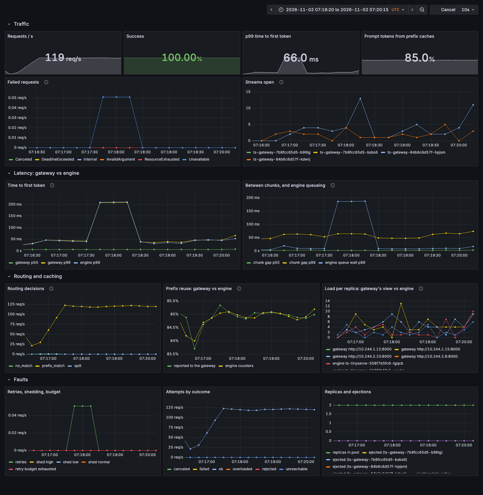
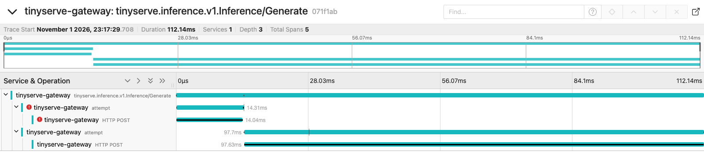

# TinyServe Gateway

A Go gateway that serves a fleet of [TinyServe](https://github.com/muralidhardon/tinyserve)
replicas over gRPC. TinyServe is my LLM inference engine: a hand-written C
transformer with a KV cache, continuous batching and int8 quantization, behind a
FastAPI server. The engine makes one replica fast. The gateway makes a fleet of
them fast and reliable:

- it routes each prompt to the replica most likely to have its prefix cached,
  without overloading it;
- it keeps streams flowing while replicas stall, crash or are replaced;
- it runs on Kubernetes, with metrics and traces showing where the time goes.



## Results

Everything ran on one Apple M3 Pro laptop. Clients were driven by
[`cmd/loadgen`](cmd/loadgen) with Poisson (open-loop) arrivals, and latencies
were measured on the client. Each table says whether it used real TinyServe
replicas or the fault-injecting fake. Raw results, and the scripts that
produced them, are in [`bench/`](bench/).

| | Before | After |
|---|---|---|
| **Prefix-aware routing**: one tenant sends 60% of the traffic (real TinyServe, 600 req/s) | p99 time to first token (TTFT) 52.8 ms (least-loaded), 55.0 ms (consistent hashing) | **17.0 ms**, with 83.6% of prompt tokens served from cache |
| **Load-aware routing**: one replica ~19x slower (real TinyServe, 100 req/s) | round-robin: p95 TTFT 24.1 s, 25 deadline misses | least-loaded: **p95 10 ms, 0 misses** |
| **A frozen replica** (`SIGSTOP`), then another killed (`SIGKILL`) | round-robin, no protection: 125 failed, p95 TTFT 2,015 ms | health checks and ejection: **8 failed, p95 19 ms** |
| **Every pod replaced** under 100 req/s (Kubernetes) | 768 of 7,437 failed, because the client's DNS re-resolution was rate-limited | **0 of 7,606 failed** |
| **A TinyServe process crashes** under 120 req/s (Kubernetes) | | **3 of 28,951 failed**: the streams already generating |
| **Telemetry cost**, gateway CPU per request | 159 µs with telemetry off | metrics +0 µs; tracing +30 µs at any sample rate |

The rest of this section gives each result's setup and caveats. Why the
gateway works the way it does is in [`docs/DESIGN.md`](docs/DESIGN.md), along
with what the measurements taught me, including the runs that went wrong.

### Prefix-aware routing

The workload is 24 tenants, each with its own system prompt of about 85
tokens plus a short question, generating 16 tokens per request. Each TinyServe
replica has a 48-block prefix cache. The tenants' prefixes need about 120
blocks: more than one replica holds, but less than the fleet does. So whether a
request finds its prefix cached depends on where it is routed.

| 600 req/s, one hot tenant (Zipf 2.0, ~60% of traffic) | Prompt reused | p50 TTFT | p99 TTFT | p99 latency | Busiest replica |
|---|---:|---:|---:|---:|---:|
| least_loaded | 78.9% | 3.0 ms | 52.8 ms | 79.2 ms | 35% |
| consistent_hash | 84.4% | 4.0 ms | 55.0 ms | 69.3 ms | 68% |
| **prefix_aware** | **83.6%** | **3.6 ms** | **17.0 ms** | **21.9 ms** | **35%** |

| 600 req/s, Zipf 1.1 | Prompt reused | p50 TTFT | p95 TTFT | p99 TTFT | Errors |
|---|---:|---:|---:|---:|---:|
| prefix cache off | 0% | 1,565 ms | 1,674 ms | 1,752 ms | 1,247 rejected |
| round_robin | 57.3% | 4.7 ms | 23.2 ms | 39.1 ms | 0 |
| least_loaded | 56.4% | 5.7 ms | 26.4 ms | 61.6 ms | 0 |
| consistent_hash | 82.1% | 3.4 ms | 9.3 ms | 22.6 ms | 0 |
| **prefix_aware** | **80.2%** | **3.4 ms** | **10.6 ms** | **22.5 ms** | **0** |

- **The engine's prefix cache matters most.**
  - Without it, prefill alone saturates the fleet at 600 req/s, and 10% of
    requests are shed.
  - With it, every router keeps p50 TTFT under 6 ms.
  - The cache is in TinyServe's
    [`streaming` branch](https://github.com/muralidhardon/tinyserve/tree/streaming).
    It cuts TTFT 5.7–7x at the engine for a prompt with a cached 64-token
    prefix.
- **Cache-affine routing raises reuse from about 57% to about 81%**, and
  cuts p95 TTFT about 2x compared with round-robin and least-loaded. Routers
  that ignore the cache spread every tenant over every replica, and every
  replica's cache thrashes.
- **Bounded load separates prefix-aware routing from consistent hashing.**
  - Both keep a prefix on the same replica, so with moderate skew they tie.
  - When one tenant is hot, consistent hashing puts 68% of all traffic on
    one replica.
  - Prefix-aware routing moves the overflow to a second replica once the
    first passes its bounded share. That replica then caches the prefix too,
    so the hit rate holds and p99 TTFT drops 3x.
- **At 300 req/s the fleet has headroom**, and the gaps shrink: 5.7 ms p95
  for both cache-affine routers against 9.9 ms for round-robin
  ([`phase3_prefix.md`](bench/results/phase3_prefix.md)).

### Load-aware routing

Three replicas, one of them much slower, 64 tokens per request.

| Real TinyServe, 100 req/s, one replica uncached (~19x slower) | p95 TTFT | p95 latency | Deadline misses | Throughput |
|---|---:|---:|---:|---:|
| round_robin | 24,097 ms | 25,680 ms | 25 / 1,524 | 34 req/s |
| **least_loaded** | **10 ms** | **196 ms** | **0** | **100 req/s** |

| Fake replicas, 150 req/s, one replica 3x slower | p95 TTFT | p95 latency | Failovers |
|---|---:|---:|---:|
| round_robin | 1,632 ms | 1,805 ms | 215 |
| random | 1,622 ms | 1,795 ms | 134 |
| consistent_hash | 1,399 ms | 1,572 ms | 5 |
| **least_loaded** | **31 ms** | **203 ms** | **0** |

Round-robin keeps sending the slow replica a third of the traffic, more than it
can serve. Least-loaded reads each replica's queue from its `/metrics` and sends
the slow one only what it can absorb: 6% of traffic on the real engine. The
slow real replica is an extreme case, an engine with its KV cache switched off.

### Fault tolerance

Four fake replicas take 150 req/s, 64 tokens per request, with a 10 s client
deadline. The faults:
- at t=8 s, one replica is frozen with `SIGSTOP`;
- at t=16 s, another is killed;
- at t=24 s, the frozen one is resumed.

A frozen replica is the hard case: its kernel still accepts connections, so
nothing errors and requests just hang.

| 4,800+ requests | Failed | Retries | p95 TTFT | p99 TTFT |
|---|---:|---:|---:|---:|
| round_robin, no protection | 125 (2.5%) | 1,278 | 2,015 ms | 2,024 ms |
| **round_robin, with protection** | **8 (0.16%)** | **77** | **19 ms** | 5,015 ms |
| least_loaded, no protection | 13 | 16 | 16.5 ms | 36.8 ms |
| **least_loaded, with protection** | **2** | **12** | **15.5 ms** | **30.1 ms** |

- **Health checks eject the frozen replica in about 2 s.**
- **Requests caught in that window** wait for the 5 s first-token timeout,
  then fail over. That window is round-robin's 5 s p99.
- **What still fails is streams already generating** when a replica dies.
  They can't be retried, because the client has already seen part of a
  completion.
- **Least-loaded survives fairly well even without protection.** The frozen
  replica's in-flight count climbs, so the router stops picking it. But
  nothing takes the replica out of rotation.

### Kubernetes

These runs used a 3-node [kind](https://kind.sigs.k8s.io/) cluster with real
TinyServe: 2 TinyServe pods, 2 gateway pods, and a loadgen pod balancing
over the gateways.

**Rolling updates.** At 100 req/s, every TinyServe pod is replaced, then every
gateway pod:

| ~7,500 requests, every pod replaced | Failed |
|---|---:|
| no drain (no `preStop`, 1 s grace period) | 2 |
| drain, client re-resolves DNS at most every 30 s (gRPC default) | 768 (10%) |
| **drain, client re-resolves DNS at most every 1 s** | **0** |

The 768 failures were the client's, not the gateway's. gRPC re-resolves a
`dns:///` name at most once every 30 s. When the second old gateway pod went
away seconds after the first, the client was left with a stale address for
about 8 s. Replacing TinyServe pods cost nothing in any run: the gateway
watches EndpointSlices and stops sending new streams to a terminating pod at
once.

**A crash, with metrics and traces.** A TinyServe process is killed with
`SIGKILL` while serving 120 req/s, with every request traced.



| Time | What happened |
|---|---|
| 07:17:29.72 | The process dies. 3 streams already generating break; they are the only failures. 2 new requests find the replica unreachable and fail over. |
| +0.8 s | Kubernetes marks the pod not-ready, and discovery drops it. No ejection was needed. |
| +2.8 s | The restarted container is ready and rejoins. |
| next ~60 s | p99 TTFT rises to about 200 ms, and the engine's own p99 rises with it: the restarted replica's prefix cache is refilling. |

One failover, in Jaeger. The first attempt hit the dead replica; the second
succeeded elsewhere:



### What telemetry costs

These runs used three fake replicas that answer instantly, so the gateway
itself is the bottleneck: 64 clients in a closed loop, 30,000 requests per
run, the median of 3 rounds.

| Telemetry | Throughput | p99 latency | Gateway CPU per request |
|---|---:|---:|---:|
| off | 27,100 req/s | 4.7 ms | 159 µs |
| metrics | 27,400 req/s | 4.8 ms | 158 µs |
| metrics + tracing, 0% sampled | 24,900 req/s | 5.5 ms | 191 µs |
| metrics + tracing, 10% sampled | 25,000 req/s | 5.6 ms | 186 µs |
| metrics + tracing, 100% sampled | 24,500 req/s | 6.5 ms | 197 µs |

- **Metrics are free.**
- **Tracing costs about 30 µs per request whatever the sample rate.** The
  gRPC and HTTP instrumentation runs on every request; recording and
  exporting the spans adds only about 8 µs more.
- **So the real choice is whether to install tracing, not how much to
  sample.** Next to a TinyServe request's milliseconds of engine CPU, either
  way is noise.

### Limits

- **One machine.**
  - Replicas, gateways and the load generator share 11 CPU cores (5
    performance, 6 efficiency) and 18 GB of memory, so absolute numbers would
    differ on real hardware.
  - Comparisons are fair within a table: same machine, same workload, run
    back to back.
  - Single runs show some noise, about ±50 ms at p99 on the cluster.
- **A tiny model.** TinyServe's model has 1.17M parameters, so a request costs
  milliseconds, not seconds. The routing wins are real but small in
  absolute terms. With a large model, prefill dominates and the same hit
  rates would save far more.
- **Autoscaling is not verified.** The chart scales TinyServe on its queue
  depth through KEDA, but KEDA never installed here: Docker on this machine
  stalls pulling its images from ghcr.io.
- **Not built:**
  - resuming a stream that fails mid-generation on another replica;
  - request hedging;
  - TLS;
  - spans inside TinyServe itself;
  - per-tenant quotas.

## What it does

- **Streaming:** server-streaming gRPC in front of TinyServe's server-sent
  events. Cancellation and deadlines reach the engine, which drops the
  sequence from its batch.
- **Routing:** round-robin, random, least-loaded (power of two choices on
  scraped queue depth) and consistent hashing. Plus prefix-aware routing: a
  chained-hash index of prompt blocks, with consistent hashing's bounded-load
  rule.
- **Fault tolerance:**
  - failover before the first token, never after;
  - active health checks, and passive ejection with exponential backoff;
  - a first-token timeout for stalled replicas;
  - a retry budget;
  - admission control that sheds low priorities first.
- **Kubernetes:**
  - replicas discovered from EndpointSlices;
  - readiness tied to discovery and drain;
  - a Helm chart with PodDisruptionBudgets, surge-only rolling updates and
    RBAC;
  - CPU or KEDA autoscaling.
- **Observability:**
  - Prometheus metrics;
  - OpenTelemetry traces with one span per attempt, carrying the replica's
    own timings;
  - a Grafana dashboard that puts gateway and engine metrics side by side.

About 2,300 lines of Go, plus 70 tests. The tests include in-process gRPC
over bufconn, a chaos test, and discovery against a fake Kubernetes API.

## Run it

Against fake replicas:

```bash
make fake                                # two fake replicas + gateway on :9000
bin/tsctl -max-tokens 40 "Alice was"     # in another terminal
```

Against real TinyServe (the
[`streaming` branch](https://github.com/muralidhardon/tinyserve/tree/streaming)):

```bash
# in the tinyserve repo, two replicas
uvicorn server.main:app --port 8001 &
uvicorn server.main:app --port 8002 &

# here
make build
bin/gateway -listen :9000 -backends http://localhost:8001,http://localhost:8002
bin/tsctl -seed 1 -max-tokens 40 "Alice was"
```

```
Alice was a moment the way off," the Hatter, it got down
was thinking of a feafe a eanarre

[24 tokens from http://localhost:8001, attempts=1, gateway ttft=7.7ms, backend latency=6.1ms]
```

Server reflection is on, so `grpcurl -plaintext localhost:9000 list` works.

On Kubernetes (local kind cluster; needs Docker, kind, kubectl and helm):

```bash
deploy/kind/up.sh                        # 3-node cluster, both images, the chart
kubectl port-forward svc/ts-gateway 9000:9000 &
bin/tsctl -max-tokens 40 "Alice was"
kubectl scale deploy/ts-tinyserve --replicas 3   # the gateway picks it up within seconds
kind delete cluster --name tinyserve
```

With dashboards and traces:

```bash
OBSERVABILITY=1 deploy/kind/up.sh        # adds Prometheus, Jaeger, Grafana
kubectl -n monitoring port-forward svc/grafana 3000 &   # http://localhost:3000
kubectl -n monitoring port-forward svc/jaeger 16686 &   # http://localhost:16686
bench/phase6_demo.sh                     # 4 min of traffic, one TinyServe crash at t=60s
```

`deploy/kind/up.sh` expects the TinyServe checkout at `../tinyserve`
(`TINYSERVE_DIR` to change it).

### Reproducing the results

| Result | Script | Needs |
|---|---|---|
| Load-aware routing (fakes) | `bench/phase2_uneven.sh` | nothing |
| Prefix-aware routing | `bench/phase3_prefix.sh` (`RATE`, `ZIPF`, `ROUTERS`) | TinyServe checkout |
| Fault tolerance | `bench/phase4_chaos.sh` | nothing |
| Rolling updates | `bench/phase5_rollout.sh` | `deploy/kind/up.sh` |
| Crash with metrics and traces | `bench/phase6_demo.sh` | `OBSERVABILITY=1 deploy/kind/up.sh` |
| Telemetry cost | `bench/phase6_overhead.sh` | Docker (for Jaeger) |

### Gateway flags

| Flag | Default | |
|---|---|---|
| `-listen` | `:9000` | gRPC address |
| `-backends` | `http://localhost:8000` | Comma-separated TinyServe base URLs (ignored with `-k8s-service`) |
| `-k8s-service` | | Discover replicas from this Service's EndpointSlices |
| `-k8s-namespace` | the pod's own | Namespace of `-k8s-service` |
| `-k8s-port` | `http` | Name of the Service port to send requests to |
| `-router` | `least_loaded` | `round_robin`, `random`, `least_loaded`, `consistent_hash`, `prefix_aware` |
| `-prefix-block-bytes` | `64` | `prefix_aware`: bytes per prefix block |
| `-prefix-load-factor`, `-prefix-slack` | `1.25`, `4` | `prefix_aware`: a replica may hold `ceil(factor × (total+1) / n) + slack` sequences and still win on cache affinity |
| `-prefix-index-blocks` | `65536` | `prefix_aware`: prefix blocks remembered |
| `-scrape-interval` | `250ms` | How often to read each replica's `/metrics` |
| `-max-attempts` | `0` (all) | Replicas one request may try before its first token |
| `-health-interval`, `-health-timeout` | `1s`, `1s` | Active `/health` checks (`0` = off) |
| `-unhealthy-threshold` | `2` | Failed checks in a row that eject a replica |
| `-outlier-failures` | `5` | Failed requests in a row that eject a replica (`0` = off) |
| `-max-ejected` | `0.5` | Largest share of the pool that failed requests may eject |
| `-ejection-base`, `-ejection-max` | `2s`, `60s` | Ejection length, doubling with each repeat ejection |
| `-first-token-timeout` | `5s` | Abandon an attempt with no text and fail over (`0` = off) |
| `-retry-budget`, `-retry-min-per-sec` | `0.1`, `10` | Retries allowed per request, plus per second (negative = unlimited) |
| `-max-inflight` | `1024` | Streams served at once before shedding, lowest priority first (`0` = no limit) |
| `-drain-timeout` | `30s` | How long SIGTERM waits for open streams |
| `-metrics-listen` | `:9090` | HTTP address for Prometheus `/metrics` (empty = off) |
| `-otlp-endpoint` | | OTLP/gRPC collector `host:port` for traces (empty = tracing off) |
| `-trace-sample` | `0.1` | Fraction of requests traced, unless the caller's `traceparent` decided |
| `-v` | off | Debug logging |

## Develop

```bash
make test    # unit + in-process gRPC tests (bufconn + fake replicas)
make race    # same, with the race detector
make proto   # regenerate gen/ after editing the .proto (needs protoc, protoc-gen-go, protoc-gen-go-grpc)
```

## Layout

```
api/proto/            gRPC API
gen/                  generated code (committed)
cmd/gateway/          the gateway
cmd/fakebackend/      fault-injecting TinyServe stand-in
cmd/tsctl/            CLI client
cmd/loadgen/          load generator
bench/                benchmark scripts and raw results
deploy/helm/          Helm chart: TinyServe, gateway, autoscaling
deploy/kind/          local 3-node cluster, setup script, Jaeger and Grafana
deploy/grafana/       the Grafana dashboard
docs/DESIGN.md        design decisions and what the measurements taught
docs/PLAN.md          the original plan
docs/img/             dashboard and trace screenshots
internal/backend/     TinyServe SSE client, /metrics scraping, health check, load and overload state
internal/pool/        the live replica set, shared by router, health checks and scraping
internal/discovery/   replicas from Kubernetes EndpointSlices
internal/health/      active health checks, outlier ejection with backoff
internal/metrics/     Prometheus metrics
internal/router/      round-robin, random, least-loaded (P2C), consistent hash, prefix-aware
internal/server/      gRPC service: admission, routing, failover, retry budget, error mapping
internal/fakebackend/ fake replica, shared by tests and cmd/fakebackend
```
